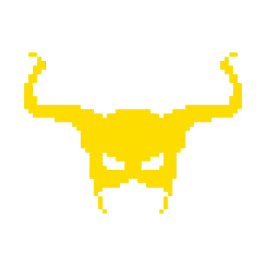

# CCC 42 — Nanofabricator

<div align="center">


&nbsp;&nbsp;&nbsp;&nbsp;&nbsp;&nbsp;


### 42nd Classic CCC · 23 October 2026 · GLS Portugal venue

[](https://www.python.org/)
[](https://numpy.org/)
[](https://nodejs.org/)

*My solution to **Nanofabricator**, the 4-hour, six-level puzzle of the 42nd Classic Cloudflight Coding Contest — and my first hackathon. Level 6 is an optimization level: write the shortest programs that make a laser fabricator build a list of patterns. This repository took the score from **72,936 to 17,436** lines.*

[]()
[]()

</div>

---

> [!IMPORTANT]
> **Final standing: 6th place at the GLS Portugal venue, competing solo against teams of up to three.**
> It was my first hackathon. Most of the level 6 work happened in the last two hours, as a race of measuring, optimizing and re-submitting.

> [!NOTE]
> **About the numbers.** The outputs in [`outputs/`](outputs/) were produced entirely by the code in this repository and total **17,436** lines. They were verified with the contest's own simulation engine, with zero failed patterns. The final leaderboard score was 15,826: in the last minutes I swapped in some outputs shared by a friend, which are not part of this repository.

---

## Table of Contents

- [The Challenge](#-the-challenge)
- [How It Can Be Solved](#-how-it-can-be-solved)
- [How We Optimized It](#-how-we-optimized-it)
- [Validation](#-validation--never-submit-blind)
- [Results](#-results)
- [Getting Started](#️-getting-started)
- [Project Structure](#-project-structure)
- [How the Event Went](#-how-the-event-went)
- [Advice for Next Editions](#-advice-for-next-editions)
- [What I Learned](#-what-i-learned)

---

## 🧩 The Challenge

> *FAB-42 is built and fully operational. Dr. Ångström invites everyone into the lab. Everyone must compete to produce a list of patterns. **The shortest programs win.***

### The machine

The **board** is a hexagon of radius `R`, printed as text. A rail (`*`) surrounds it, `O` is an empty cell and `-` is padding between the staggered hex columns:

```
---*-*-*-*---
--*-O-O-O-*--
-*-O-M-M-O-*-
*-O-M-O-O-O-*
-*-O-M-M-O-*-
--*-O-O-O-*--
---*-*-*-*---
```

**Six emitters** ride on the rail. The rail has `6R` positions and emitter `i` starts at the corner `i·R`. Each emitter always fires in **its own fixed direction**: E, SE, SW, W, NW or NE. In text-grid coordinates `(row, col)`, these are `(0,+2)`, `(+1,+1)`, `(+1,−1)`, `(0,−2)`, `(−1,−1)` and `(−1,+1)`.

A **program** is a list of lines. Each line holds one instruction per emitter:

| Instruction | Effect |
|---|---|
| `F` | move one step clockwise along the rail |
| `B` | move one step counter-clockwise |
| `T` | toggle the emitter on / off |
| `-` | do nothing |

Each line is one **cycle**:

```
apply the six instructions
for every cell, count how many active rays cross it
    exactly 2 hits  -> the cell becomes MATTER
    3 or more hits  -> the cell is cleared
    1 hit           -> nothing happens
matter persists from cycle to cycle
if every M of the pattern is matter AND no "skirting" cell is matter:
    the pattern is accepted and its matter is removed
```

A **skirting cell**, which this README calls a **halo** cell, is an empty pattern cell that touches an `M`. Halo cells must be empty at the moment of acceptance. **Every other cell is "don't care"**: stray matter anywhere else on the board is allowed. That single rule is what makes every optimization below possible.

### The six levels

| Level | Task |
|---|---|
| 1 | Draw the empty board for a radius |
| 2 | Fire emitters onto a board |
| 3 | Apply the hit-count rule (2 hits → matter, 3+ → cleared) |
| 4 | Simulate a full program and print the final board |
| 5 | Count how many patterns a program gets accepted |
| **6** | **Write the programs yourself.** Each pattern must be produced `count` times; **score = total number of lines; lower is better** |

Levels 1–5 build the simulator. Level 6 is the real contest: an open-ended optimization level with four input files (small, medium, large, enormous). Only the last three are scored, with 540 patterns in total and boards up to radius 12.

---

## 🧠 How It Can Be Solved

### Geometry first: three families of lines

Opposite emitters fire along parallel lines: E/W along rows, SE/NW along one diagonal, SW/NE along the other. So the six emitters form **three families with two emitters each**.

An emitter's position on the rail decides **which line** (chord) of its family it covers. Moving it one step shifts that chord by one. Every cell sits on exactly one chord per family. [`geometry()`](resolution.py) precomputes, for every emitter and rail position, the set of cells its ray crosses, and for every cell, the position that hits it.

### The obvious solution: a pen

Two emitters from **different** families cross at exactly one cell. That cell gets 2 hits and turns into matter, while every other cell on both rays gets only 1. So a pair of emitters is a **pen** that draws one cell per cycle. Moving both emitters moves the crossing point like a chess king.

The baseline solver walks the pen through the pattern with a BFS, never stepping onto a halo cell. It is correct, simple and slow: about **one cell per line**. Level 6 total: **72,936**.

---

## 🚀 How We Optimized It

Every number below is the level 6 total (medium + large + enormous). Each step was measured before it was kept.

| Step | Technique | Total |
|---|---|---:|
| 0 | Pen: two emitters, one cell per cycle | 72,936 |
| 1 | **Chord stamps** on clean chords | 49,640 |
| 2 | **Painting** for dirty chords, more variants | 36,627 |
| 3 | Painting planned from the emitters' real state | 30,400 |
| 4 | Stamp + erase; idle emitters already travelling | 29,755 |
| 5 | **Vectorised greedy**: all 4,096 moves per cycle in numpy | 24,110 |
| 6 | Seeded noise, best of several runs | 22,182 |
| 7 | **2-step lookahead** + **copy ping-pong** | 19,165 |
| 8 | **Beam search** | 18,347 |
| 9 | Wider beam, more seeds | **17,436** |

### 1 · Chord stamps

Put **both emitters of one family on the same line**. Every cell of that chord gets 2 hits, so the whole chord becomes matter in a single cycle: up to 23 cells per line instead of 1.

The problem is the halo cells on that chord. They would become matter too. The fix is to **punch** them: each of the four remaining emitters crosses the chord at one cell, and a halo cell with a crossing line gets **3 hits**, so it stays empty.

```
cells on the chord:   free  halo   M   M   M   M  halo  free
two parallel rays:     2     2     2   2   2   2    2     2
+ punch lines:               +1                     +1
total hits:            2     3     2   2   2   2    3     2
after the cycle:       m     .     m   m   m   m    .     m     (m = matter, harmless outside)
```

A chord with **at most four halo cells** can be stamped in one line. The solver sweeps the pattern chord by chord, moving the pair one chord per line, and reverses direction on every copy so there is never a trip back. It tries all three families and both directions and keeps the shortest result. ([`chord_program`](resolution.py))

**The timing planner** turns the sequence of stamps into lines:
- **Frames:** each stamp is a configuration of active emitters at fixed positions.
- **Pre-positioning:** a switched-off emitter can travel freely, so it moves ahead toward its next job.
- **Waiting:** if an active emitter must jump more than one step, the planner either repeats the previous frame (always safe) or does a reset: switch everything off, move, switch back on.
- **Punch assignment:** choosing which emitter punches which halo is a tiny assignment problem (≤ 24 permutations), chosen to minimise waiting.

### 2 · Painting dirty chords

Chords with more than four halos cannot be stamped. For those, **one** emitter stays on the chord (1 hit everywhere) and the other four become **painters**: wherever a painter crosses the chord, that cell gets 2 hits.

A painter slides along a run of target cells, painting one per cycle, and switches off to hop over a halo. The first version planned painters as if they started from their initial corners, which produced dozens of idle frames. Planning from the emitters' **real** positions and timers (step 3), and counting the distance an idle emitter had already covered (step 4), removed most of them.

**Stamp + erase** is the other answer for chords with 5–6 halos:
1. Stamp the chord anyway, punching four of the halos.
2. Erase the leftover halos in the next frame by crossing **three lines on each one**: the chord's own emitter plus one line from each other family.

It works, but the extra travel ate most of the gain.

### 3 · The vectorised greedy

Sweeping chords is great for solid blobs and terrible for maze-like patterns, where every chord crosses dozens of halos. So the second engine forgets about chords entirely and searches move by move.

Each cycle, every emitter has 4 options, so there are **4⁶ = 4,096 possible lines**. All of them are scored in one shot with numpy:

1. For each family, build the 16 combined hit vectors of its two emitters from precomputed `int8` ray masks.
2. Broadcast them to a `16 × 16 × 16 × cells` tensor of hit counts.
3. **Reject** any line that gives a halo exactly 2 hits, or destroys an already-drawn target.
4. **Score** the rest:

```
score(line) = 100 · new_cells(line)  +  Σ  decay^cost(x)  −  0.01 · moves(line)
                                        x ∈ targets not yet drawn

cost(x)   = sum of the two smallest family distances to the lines through x
d_F(x)    = min over the family's two emitters of (rail distance to x's line, +1 if switched off)
```

The potential term pulls emitters toward unfinished regions even when nothing can be drawn this cycle. A **focus mode** kicks in when no progress is made for a while: it aims at the single easiest target and switches off emitters that are in the way. That cured the stalls near the end of a copy.

Because the halo rule is enforced on every single cycle, any program the greedy produces is valid by construction. Small random noise on the scores (`noise`, `seed`) plus *best of several runs* added another 8%.

### 4 · Lookahead, then beam search

A one-step greedy is myopic. Two upgrades, both measured on the same sample:

On a 40-pattern medium sample with the same seed, a **2-step lookahead** went from 1,619 to **1,378** lines (−15%). For each of the 6 best moves it adds the value of the best follow-up move, at about 5× the cost. Then, on a 24-pattern large sample:

| Search | Lines | Cost vs. plain greedy |
|---|---:|---:|
| 2-step lookahead (K = 6) | 674 | ~5× |
| 2-step lookahead (K = 16) | 649 | ~12× |
| **Beam search (W = 6, C = 4)** | **622** | **~5×** |
| Beam search (W = 12, C = 4) | 600 | ~10× |

**Beam search** keeps the `W` best states and expands the `C` best moves of each. It deduplicates identical states (positions, on/off, matter) and stops at the first state that finishes every copy. It can sacrifice a line now to save several later, which a greedy never does. ([`greedy_beam`](level6_optimizer.py))

### 5 · Copy ping-pong

Most patterns must be built several times; medium has patterns with up to 19 copies. After each acceptance, the greedy starts again from wherever the emitters happen to be. Instead:

1. Take the **segment of lines that built the cheapest copy**.
2. Replay it **backwards**: one hold line, then the segment reversed, with `F` and `B` swapped.
3. Replay it forwards again, and so on.

Undoing the moves visits exactly the same configurations in reverse order, so every cycle produces the same hits. Each extra copy now costs exactly the segment length.

Reversing does change the *order* in which 3-hit clearings happen, so every ping-pong program is re-simulated before it is kept. ([`pingpong`](level6_optimizer.py))

### 6 · Best of everything

For every pattern, the pipeline:
- builds the chord planner's 12 variants (3 families × 2 directions × 2 painter modes) and the pen;
- builds several beam-search variants;
- keeps the **shortest valid program**, then applies ping-pong.

It runs on all CPU cores with `multiprocessing`. Successive rounds with new seeds only replace a pattern's program when the new one is shorter, so the score can only go down.

---

## ✅ Validation — never submit blind

Halfway through the contest, two uploads came back with penalties of +777,730 and +719,904. That size means *every* pattern of the file failed.

Instead of guessing, I extracted the simulation engine from the contest's own `sandbox-level-6.html` and ran it in Node over all 540 outputs. Zero failures: the files were right and the upload had gone into the wrong slot. From then on, **no file was uploaded without passing the official engine first**. ([`tools/grade.js`](tools/grade.js))

```bash
node tools/grade.js path/to/sandbox-level-6.html in_level-6_3-large.txt outputs/out_level-6_3-large.txt
```

```
patterns 190 programs 190 failures 0 lines 5756
```

---

## 📊 Results

| File | Patterns | Baseline (pen) | Final | Reduction |
|---|---:|---:|---:|---:|
| medium | 210 | 27,795 | **6,453** | −77% |
| large | 190 | 23,751 | **5,756** | −76% |
| enormous | 140 | 21,390 | **5,227** | −76% |
| **Total** | **540** | **72,936** | **17,436** | **−76%** |

All three outputs pass the official engine with **0 failed patterns**.

---

## 🛠️ Getting Started

**1. Clone and install**

```bash
git clone https://github.com/EduhxH/ccc-42-nanofabricator.git
```

```bash
cd ccc-42-nanofabricator
```

```bash
python -m pip install -r requirements.txt
```

**2. Get the inputs.** The input files and the sandbox belong to Cloudflight and are not included. Download the level 6 package from the contest platform and put `in_level-6_*.txt` in the repository root; they are git-ignored.

**3. Run**

```bash
python level6_optimizer.py
```

This runs the full pipeline (chord planner + beam search + ping-pong) on every core and writes `out_level-6_*.txt`. Expect tens of minutes on a 4-core laptop. The outputs in [`outputs/`](outputs/) are the best of several rounds with different seeds, so a single run lands slightly above them.

`resolution.py` on its own solves levels 1–5 and runs the chord planner for level 6 (set `LEVEL` at the top):

```bash
python resolution.py
```

**4. Validate** with the official engine (needs Node.js and the contest's `sandbox-level-6.html`):

```bash
node tools/grade.js path/to/sandbox-level-6.html in_level-6_2-medium.txt out_level-6_2-medium.txt
```

---

## 📂 Project Structure

```
ccc-42-nanofabricator/
├── resolution.py          # Levels 1-6: board, simulator, chord planner, painting, stamp+erase
├── level6_optimizer.py    # Level 6 pipeline: vectorised greedy, beam search, ping-pong, multiprocessing
├── tools/
│   └── grade.js           # Runs the official engine (extracted from the sandbox) over an output file
├── outputs/               # Final level 6 outputs (17,436 lines, 0 failures)
├── assets/                # Logos
└── requirements.txt       # numpy
```

The code comments are in Portuguese; the code was written during the contest.

---

## 🎉 How the Event Went

This was my **first hackathon**, and it was extremely fun.

I competed **solo** at the GLS Portugal venue, against teams of up to three. Levels 1 to 5 were about building the simulator piece by piece. Level 6 turned into a four-hour race on a live leaderboard: every improvement meant generating, validating and uploading again, while watching the scores of the people around me move at the same time. Going from 72,936 to a 6th place finish in an afternoon is something I will remember.

I have to be honest about one thing: in the final stretch, **AI was used extremely, by everyone**. The room turned into a race of prompting, measuring and re-submitting, and I was no exception: most of this optimization was built pair-programming with an AI assistant. It changes what a contest like this tests. Less "who can write the algorithm" and more "who understands the problem well enough to steer, measure and verify". I learned a lot from doing exactly that, especially the habit of never trusting a result I had not validated.

The best part was not the score. It was the people. Between levels and after the end, I talked with other participants, compared approaches, traded ideas, and left with **new people to know and new connections** that I would not have made otherwise.

---

## 💡 Advice for Next Editions

### Improving this code

- **Allow temporary halos ("stamp and sculpt").** Comparing outputs after the contest showed what the top solutions did differently:
  - they kept about **4.8 emitters active per cycle**;
  - they had a same-family pair (a stamp) active in **~93% of cycles**;
  - they occasionally let a halo become matter and **cleared it later with 3 hits**.

  My greedy forbids halo matter on every cycle, so it can almost never stamp: every full chord crosses some halo. Turning that hard rule into a penalty, with a reward for clearing halos, is the biggest missing gain. The acceptance check stays strict, so programs remain correct.
- **Beam search over stamps.** Add "move the pair onto the same chord" as a first-class move, so the search can plan stamps instead of stumbling into them.
- **Search for cycles directly.** Ping-pong reuses the best copy the greedy happened to find. Searching for the shortest closed loop of configurations that builds one copy would make every multi-copy pattern cheaper.
- **Speed is score.** In an optimization level, more runs means a lower score. The hot loop (scoring 4,096 moves) would be much faster in C++, Rust or Numba, which means wider beams and more seeds in the same time.
- **Persist the best per pattern automatically.** Keep a per-pattern "best so far" store from the first minute, so every experiment can only improve the submission.

### Using your time

- **Read only what matters.** In each level PDF, read the rules page and the input/output page first; skip the story pages.
- **Build the simulator and a validator before optimizing.** A trustworthy grader is worth more than any heuristic, and it saved this run.
- **Submit early, then improve.** A valid mediocre score on the board beats a brilliant one still on your disk.
- **Measure where the cost goes before changing code.** Counting idle lines (setup, waits, empty frames) pointed straight at the biggest wins.
- **Run experiments on a sample.** 24–40 patterns are enough to compare two ideas in a minute.
- **Use every core and keep them busy.** While one round runs in the background, design the next one.
- **Protect the upload.** Never upload a file while a job may be rewriting it. Check the file name before dropping it, since auto-assign matches by name, and `in_` and `out_` files share it. Watch the clock and stop optimizing about 15 minutes before the end.
- **Keep each level's solution separate.** Copy the script per level; later levels reuse earlier ones.

---

## 🧠 What I Learned

- **Constraints define the search space.** "Only skirting cells must be empty" is the rule that makes stamps, junk matter and the whole optimization possible. Reading the rules precisely was worth more than any algorithm.
- **Vectorise the decision, not just the data.** Scoring all 4,096 moves of a cycle as one numpy tensor turned an impossible Python loop into milliseconds.
- **Greedy → lookahead → beam.** Each step bought a measurable improvement for a known cost, and a table of both made the choice easy.
- **Symmetry is free work.** Undoing a move sequence visits the same configurations, so a copy can be rebuilt by playing it backwards.
- **Verify against the real thing.** Extracting the official engine turned "the upload failed" from panic into a two-minute diagnosis.
- **Under time pressure, measure first.** Every big gain in this repository came from first asking where the lines were going.

---

<div align="center">
  Made with 💛 at my first hackathon by <a href="https://github.com/EduhxH">EduhxH</a>
</div>
